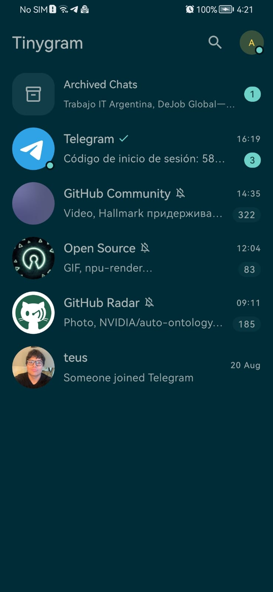
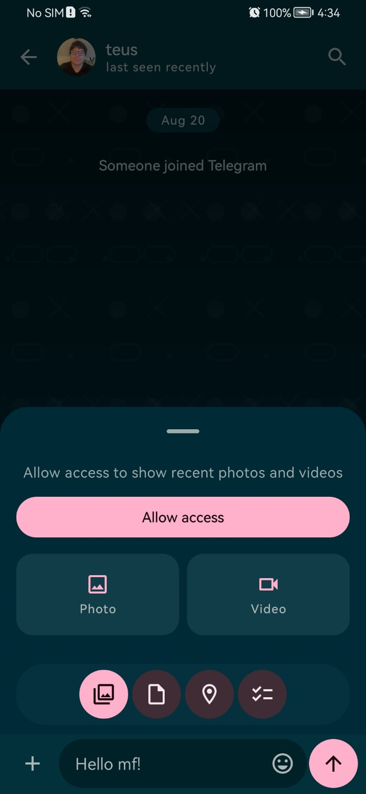
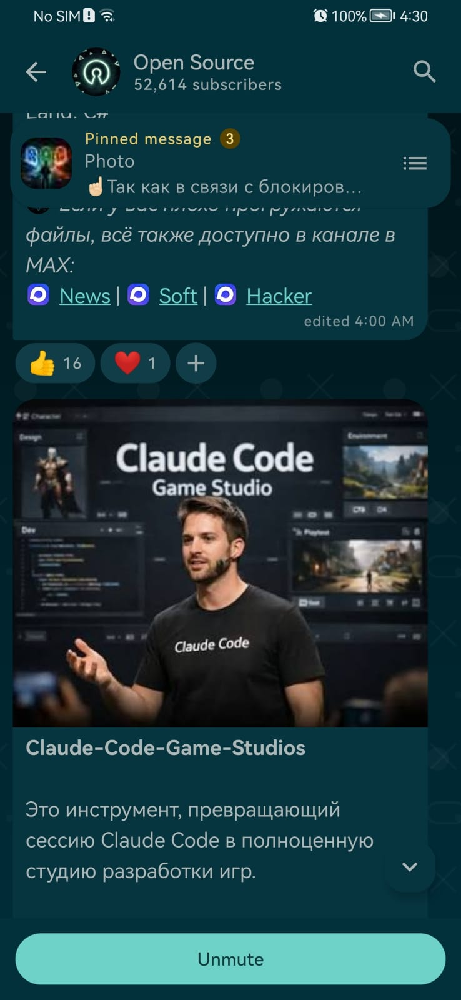
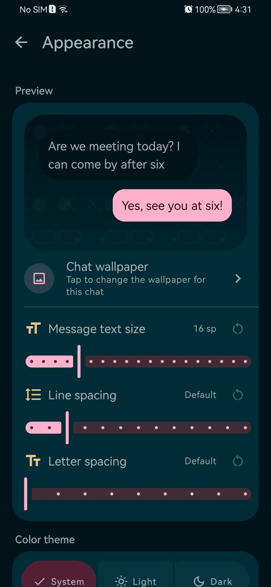
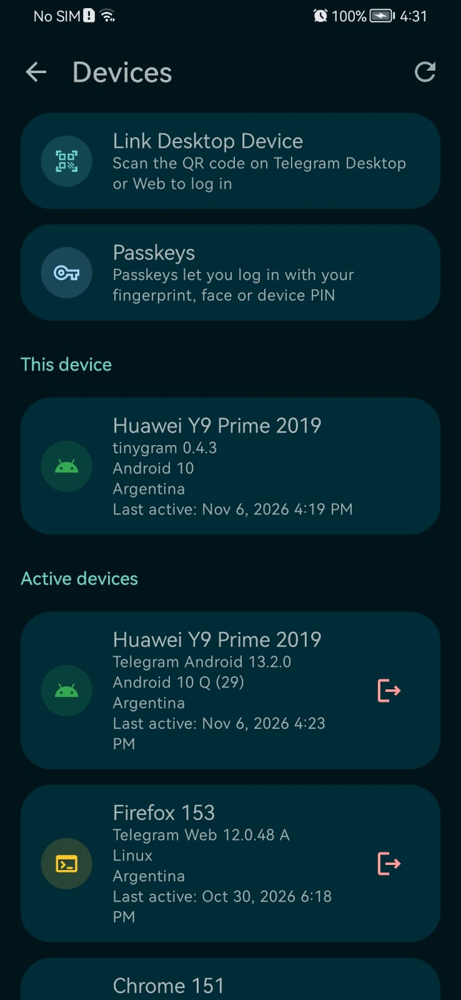
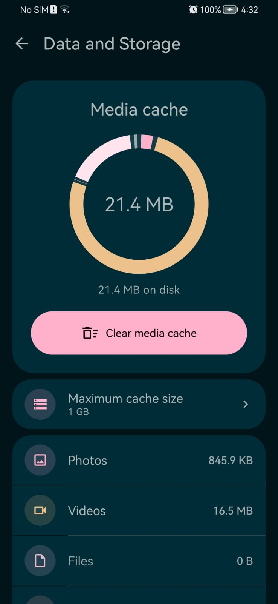
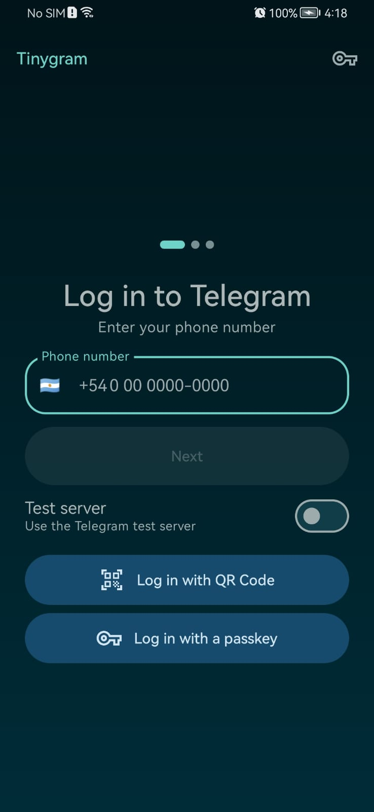

<div align="center">
  

  <h1>Tinygram</h1>

  <p><strong>A more thoughtful Telegram experience for Android.</strong></p>

  <p>
    Tinygram is an unofficial, native Telegram client built with Kotlin, Jetpack Compose,
    and a Rust-powered MTProto core. Familiar messaging, a modern interface, and an
    Android-first approach.
  </p>

  <p>
    
    &nbsp; Android 7.0+ &nbsp;·&nbsp; Kotlin + Compose &nbsp;·&nbsp; Rust + MTProto
  </p>

  <p>
    <a href="./LICENSE"></a>
    
  </p>

  <p>
    <a href="#the-experience">Experience</a> &nbsp;·&nbsp;
    <a href="#screenshots">Screenshots</a> &nbsp;·&nbsp;
    <a href="#under-the-hood">Architecture</a> &nbsp;·&nbsp;
    <a href="#build-from-source">Build</a>
  </p>
</div>

<p align="center">
  
</p>

> [!NOTE]
> Tinygram is in active development. Some functionality may be incomplete or change between builds. This is an independent, unofficial Telegram client and is not affiliated with Telegram.

## The experience

- **Android, first.** A fully native interface built with Jetpack Compose and Material 3—not a web view or a port of another platform's UI.
- **Conversations at the center.** Chats, groups, folders, and everyday messaging features, without unnecessary distractions.
- **Designed for more screens.** Adaptive layouts for phones, tablets, and foldable devices.
- **Rich media, naturally.** Photos, video, animated stickers, and in-conversation media experiences.
- **Made to feel personal.** Appearance and layout options that let the interface fit your preferences.
- **A fast native foundation.** Kotlin UI on top of Rust-based MTProto networking, connected through UniFFI.

## Screenshots

<p align="center"><sub>A look at Tinygram across conversations, settings, and everyday use.</sub></p>

<table align="center">
  <tr>
    <td align="center"></td>
    <td align="center"></td>
    <td align="center"></td>
    <td align="center"></td>
  </tr>
  <tr>
    <td align="center"><sub>Home</sub></td>
    <td align="center"><sub>Chats</sub></td>
    <td align="center"><sub>Groups</sub></td>
    <td align="center"><sub>Appearance</sub></td>
  </tr>
  <tr>
    <td align="center"></td>
    <td align="center"></td>
    <td align="center"></td>
    <td></td>
  </tr>
  <tr>
    <td align="center"><sub>Devices</sub></td>
    <td align="center"><sub>Storage</sub></td>
    <td align="center"><sub>Sign in</sub></td>
    <td></td>
  </tr>
</table>

## Under the hood

Tinygram separates the presentation layer from the messaging protocol. Jetpack Compose handles the Android experience; the Rust MTProto implementation provides the native client foundation.

| Layer | Technology |
| --- | --- |
| Android UI | Kotlin, Jetpack Compose, Material 3 |
| Navigation & state | Decompose, MVIKotlin, Coroutines, Flow |
| Dependency injection & persistence | Koin, Room |
| Telegram protocol | Rust, [mono-rs](https://github.com/monogram-android/mono-rs), UniFFI |
| Media | Media3, Coil, libvpx, tlottie |
| Notifications | Firebase Cloud Messaging, UnifiedPush |
| Development environment | Gradle, Android SDK/NDK, Rust, [devenv](https://devenv.sh/) |

<details>
<summary><strong>Explore the project structure</strong></summary>

| Directory | Purpose |
| --- | --- |
| `app/` | Android entry point, navigation, and application integration |
| `feature/` | Authentication, chats, dialogs, folders, profiles, and settings |
| `core/` | Shared UI, models, persistence, and utilities |
| `network/` | Kotlin protocol bridge, HTTP transfers, and media cache |
| `native/mtproto-rs/` | Rust MTProto client and UniFFI exports |
| `native/markup-rs/` | Markdown parsing, code highlighting, and math extraction |
| `native/mtproto/`, `native/markup/` | Kotlin/native integration and generated bindings |
| `vendor/` | Pinned third-party dependencies and Git submodules |

UI features depend on the Kotlin bridge rather than generated UniFFI types. See [AGENTS.md](./AGENTS.md) for development conventions and architectural boundaries.

</details>

## Build from source

### Requirements

- Android Studio or a compatible Android SDK/Gradle environment
- Android SDK Platform **37**, Android NDK **r28c** (28.2.13676358)
- **JDK 17** for the launcher/source compatibility and **JDK 25** for the configured Gradle daemon
- **Rust 1.98+**, Cargo, `cargo-ndk`, and the Android Rust targets

On Linux, the repository includes a reproducible [devenv configuration](./devenv.nix) that provisions the required Android and Rust toolchains. With Nix and devenv installed:

```bash
git clone --recurse-submodules https://github.com/4beru/tinygram.git
cd tinygram
devenv shell
```

If you use Android Studio or manage toolchains yourself, clone with `--recurse-submodules`, install the prerequisites above, and use the Gradle wrapper from the repository root.

### Configure your Telegram credentials

Copy `local.properties.example` to `local.properties` and set the Android SDK path along with your own `API_ID` and `API_HASH` from [my.telegram.org/apps](https://my.telegram.org/apps).

```bash
cp local.properties.example local.properties
```

The project can build without Telegram credentials, but signing in requires valid values. Never commit `local.properties`, signing keys, or service credentials.

On Linux, the included `tinygram-configure` helper can configure local credentials from `pass` if you've set up the documented entries. See the [local development guide](./documents/DEVELOPMENT_ES.md) for the reproducible environment and USB-device workflow.

### Compile and install

```bash
./gradlew :app:assembleDebug
./gradlew :app:installDebug
```

The install task requires a connected Android device or emulator. To reduce native build work for a particular device, you can select an ABI, for example:

```bash
./gradlew :app:installDebug -PtargetAbi=arm64-v8a
```

Gradle builds the native Rust libraries and UniFFI bindings as part of the normal process. For distribution variants, use `./gradlew :app:assembleRelease` or `./gradlew :app:assembleBeta`. Release signing must be configured separately; otherwise, the project currently falls back to debug signing. Windows users can replace `./gradlew` with `gradlew.bat`.

> **Implementation note:** Some internal names still reflect the upstream codebase. In particular, the Android application ID is currently `org.monogram` (`org.monogram.debug` for debug builds).

<details>
<summary><strong>Native markup module</strong></summary>

The Rust `native/markup-rs` crate provides Telegram Markdown/entity parsing, block rendering, syntax highlighting, and math extraction to Kotlin via UniFFI.

| API | Role |
| --- | --- |
| `parse_telegram_markdown` | Plain text and Telegram entities |
| `render_blocks` | Markdown structures for local display |
| `highlight_code` | Lexical code highlighting |
| `extract_math` | Inline and block math spans |
| `supported_highlight_languages` | Supported highlight identifiers |
| `library_version` | Crate version |

Entity and syntax spans use UTF-16 offsets. Highlighting is lexical rather than semantic; oversized inputs fall back to unformatted text. Host tests and a standalone native build can be run with:

```bash
cargo test --manifest-path native/markup-rs/Cargo.toml
./gradlew :native:markup:buildNativeMarkup
```

</details>

## Contributing

Contributions are welcome. Branch from `develop` and open pull requests against `develop`. Keep changes focused, follow the existing module boundaries, and include relevant tests or verification. Please respect the [Telegram API Terms of Service](https://core.telegram.org/api/terms).

## Credits & license

Tinygram builds on the open-source [Monogram](https://github.com/monogram-android/monogram) project and its [mono-rs](https://github.com/monogram-android/mono-rs) MTProto stack. Credit also belongs to the maintainers of the libraries used throughout the project.

Licensed under the [GNU General Public License v3.0](./LICENSE). Third-party dependencies retain their respective licenses.
